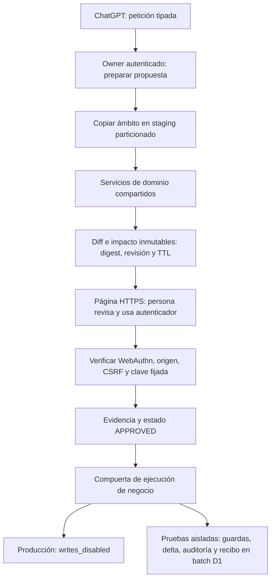

# Arquitectura

## Capas

1. **Interfaz React/Vinext**: módulos de resumen, tareas, planificación, proyectos, finanzas, bitácora y configuración.
2. **API Edge**: `/api/state` entrega una vista combinada y `/api/action` aplica comandos validados.
3. **Servicios de dominio**:
   - `home-server.ts`/`v2-server.ts`: facades del entorno Cloudflare para la UI.
   - `lib/domain/home-service.ts` y `v2-service.ts`: única lógica de tareas, contexto, calendario y finanzas. Contexto de request inyecta D1 y reloj; UI usa su binding y preparación usa staging aislado.
4. **D1**: fuente persistente y autoritativa. Los totales financieros se derivan de registros base; no se guardan como cifras duplicadas.

### Superficie MCP de lectura

- `POST /mcp`: JSON-RPC MCP 2026-07-28, separado de `/api/action`.
- Sites autentica al visitante y reenvía identidad verificada; el endpoint aplica además una política owner-only configurada en servidor.
- `lib/mcp/server.ts`: protocolo, catálogo, validación cerrada y routing.
- `lib/mcp/read-service.ts`: consultas paginadas y aisladas por alcance; solo acepta `SELECT`.
- Las tareas, áreas y proyectos usan el alcance compartido del hogar. Finanzas, calendario y auditoría usan el `owner_id` autenticado.
- No hay herramientas MCP de escritura en Fase 1.

## Decisiones de integridad

- Dinero nuevo en enteros de centavos.
- Transferencias restan principal en origen y suman en destino; solo sus comisiones afectan patrimonio/neto, sin ingreso/gasto ficticio por el principal.
- Movimientos con fecha futura aparecen en la proyección, no en el saldo actual.
- Presupuesto consumido = gastos confirmados de la misma categoría y mes.
- Gasto de tarea/proyecto = suma de transacciones confirmadas vinculadas hasta hoy.
- Anulación lógica de movimientos con registro en auditoría.
- Restauración validada antes de reemplazar registros.
- Migraciones aditivas; las tablas históricas no se recrean ni pierden identificadores.
- Las lecturas no ejecutan inicializaciones, siembras ni migraciones; estas permanecen en los flujos manuales de escritura.

## Identidad y alcance

El encabezado `oai-authenticated-user-id` determina la propiedad de finanzas y eventos. La membresía del Site sigue siendo el perímetro de acceso. El modo de vista previa usa una identidad local aislada únicamente para QA.

## Propuestas de fases 3–7 (opt-in de desarrollo)

La compuerta está fijada en false en fábrica y transporte; el camino de ejecución solo se habilita en el constructor de pruebas aisladas. No hay API/modelo que apruebe, fije claves o abra esa compuerta. Staging no se convierte en una segunda interpretación de saldos: ejecuta los mismos servicios sobre copias acotadas. Los triggers de todas las tablas de negocio invalidan planes ante cambios concurrentes, incluida UI. Ver PHASE3_TECHNICAL_PLAN, HUMAN_APPROVAL_SETUP y MCP_HARDENING para contratos y límites.

