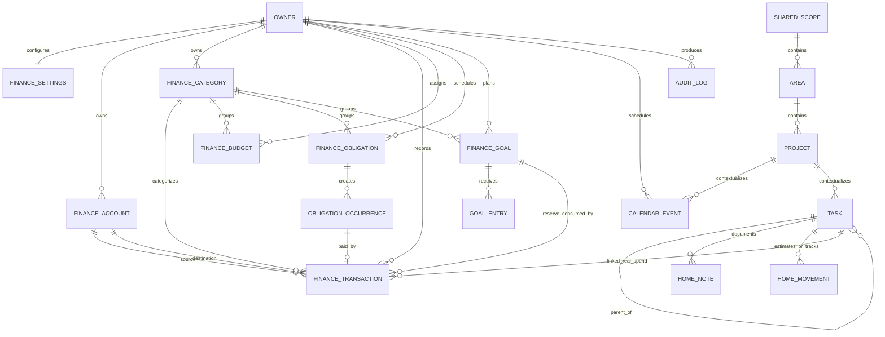

# Vida en Orden — mapa de entidades para MCP

## Tablas reales

| Grupo | Tablas |
|---|---|
| Trabajo | `home_workspaces`, `home_tasks`, `home_notes`, `home_movements` |
| Organización | `home_areas`, `home_projects` |
| Tiempo | `calendar_events` |
| Finanzas | `finance_accounts`, `finance_categories`, `finance_concepts`, `finance_transactions` |
| Presupuesto | `finance_budgets` |
| Obligaciones | `finance_obligations`, `finance_obligation_occurrences` |
| Metas | `finance_goals`, `finance_goal_entries` |
| Control | `finance_settings`, `audit_log` |

Las relaciones se representan principalmente mediante IDs y validaciones en servicios. El esquema SQL auditado no declara claves foráneas para proteger esos vínculos a nivel de base de datos; el motor de propuestas MCP deberá validar cada referencia antes de aprobar y volver a validarla al ejecutar.

## Alcances

- `owner_id`: finanzas, eventos, metas, obligaciones, presupuestos, cuentas, categorías, conceptos y auditoría.
- `scope_id = casa-en-orden-shared`: áreas, proyectos y tareas heredadas compartidas.
- Tarea/proyecto pueden ser vínculos de una transacción financiera; ese vínculo no convierte la transacción en dato compartido.
