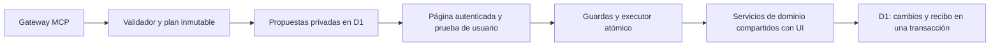

# Fase 3: propuestas y aprobación verificable

Estado: **diseño para revisión, implementación no iniciada**. Depende del cierre del saneamiento remoto descrito en `HISTORY_SANITIZATION_PLAN.md` y de aprobar este plan. Esta propuesta no agrega rutas, herramientas, tablas ni permisos MCP. Se conservan las 31 lecturas y `MCP_BUSINESS_WRITES_ENABLED=false`.

## Punto de partida comprobado

- `lib/mcp/server.ts` valida contratos cerrados y registra 31 herramientas de lectura. No hay router de propuestas ni de ejecución.
- `lib/mcp/auth.ts` verifica identidad de Sites y política owner-only. Los argumentos del modelo no determinan propietario ni scope.
- `lib/mcp/future-contracts.ts` contiene tipos reservados, sin persistencia ni implementación. `ProposedAction.kind` es texto abierto: debe convertirse en una unión discriminada, no usarse como un despachador genérico.
- `lib/home-server.ts` y `lib/v2-server.ts` ejecutan mutaciones de UI mediante múltiples llamadas `.run()` y algunos `.batch()`. Inicializan defaults en flujos de escritura. No proporcionan una transacción única para un plan intermodular ni versiones CAS compartidas con la UI.
- `app/api/action/route.ts` conserva las escrituras normales y una restauración compuesta; no es un executor seguro para MCP. No se invocará por HTTP desde el router MCP.
- El esquema tiene ocho migraciones, sin tablas de propuestas, aprobación o ejecución y sin versionado universal de entidades. La lógica financiera pura existe en `lib/finance-math.ts` y se reutilizará.
- Sites suministra identidad autenticada. No se observó una capacidad que firme un evento de aprobación humana del host. Identidad válida y una llamada hecha por un agente no prueban por sí solas una aprobación humana de un digest.

## Arquitectura propuesta

Componentes previstos, todavía sin crear:

| Componente | Responsabilidad |
|---|---|
| `lib/mcp/plans/contracts.ts` | Unión cerrada de acciones, límites y versiones del contrato. Rechazar SQL, tablas, URLs, patches y propietarios del llamador. |
| `lib/mcp/plans/planner.ts` | Leer un snapshot autorizado, normalizar, resolver referencias locales, calcular diff e impactos y clasificar riesgo. Sin escritura de negocio. |
| `lib/mcp/plans/canonical.ts` | Canonicalización versionada y digest SHA-256 calculado por el servidor. |
| `lib/mcp/plans/repository.ts` | Propuestas inmutables, revisiones, TTL y acceso privado por instalación/propietario. |
| `lib/mcp/plans/approval.ts` | Nonce/challenge, comprobación de prueba de usuario y consumo de aprobación. Nunca aceptar `confirmed=true`. |
| `app/approvals/…` y endpoints privados | Mostrar el diff exacto y recoger la acción humana. Una visita GET no aprueba ni ejecuta. |
| `lib/mcp/plans/executor.ts` | Revalidar, consumir autorización y persistir resultado atómico e idempotente. |
| Servicios de dominio | Producir comandos preparados sin ejecutar individualmente; UI y MCP deben compartir esta capa. |

## Contrato de propuesta y máquina de estados

La propuesta contiene `proposalId`, `installationId` propio, propietario derivado de identidad, revisión, versión del contrato, acciones ordenadas, referencias locales tipadas, precondiciones, diff, riesgo, tiempos UTC y digest. Los IDs generados se fijan al preparar el plan para permitir una ejecución determinista. No aceptar IDs de propietario ni `expectedVersion` aportados libremente para sustituir la lectura del servidor.

Usar un serializador conforme a RFC 8785, evaluado y fijado en el lockfile cuando se implemente. Rechazar números no finitos, claves duplicadas, valores no representables y campos desconocidos antes de calcular la huella; dinero exclusivamente en enteros seguros de centavos. El material del digest incluye un separador de dominio, instalación, propietario, revisión, versión de contrato, acciones, IDs previstos, precondiciones, diff y caducidad. No calcular hashes a partir de una concatenación ambigua o de un resumen redactado por el modelo.

Estados: `DRAFT → VALIDATED → PENDING_APPROVAL → APPROVED → EXECUTING → COMMITTED`; terminales `REJECTED`, `CANCELLED`, `EXPIRED`, `INVALIDATED`, `FAILED`. No hay ejecución parcialmente exitosa en el MVP. Revisar cambia la revisión/digest y anula la aprobación anterior. Un estado desconocido falla cerrado.

Límites iniciales propuestos: 20 acciones, cuerpo de 64 KiB acorde con el transporte actual, 10 minutos de vigencia y tamaño acotado de diff/resultado. El reloj de autorización es del servidor/base, nunca el del cliente. Se comprueba caducidad en aprobación y dentro de la transacción de commit; documentar que el límite aplica al inicio autorizado de ese commit. No renovar TTL mediante polling o reintentos.

## Prueba de aprobación humana

El canal preferido puede ser un control del host **solo si** la plataforma entrega una prueba firmada y validable que vincule usuario, instalación, propuesta, revisión, digest, challenge y tiempo. Una anotación MCP, un booleano del modelo, `event.isTrusted` remitido por JavaScript o un «sí» en el chat no cumplen esa condición.

MVP recomendado para investigar: página de aprobación del mismo Site, abierta como navegación de nivel superior, protegida por identidad de Sites y política owner-only. Mostrar todos los efectos y pedir una acción específica. Usar POST, origen exacto, protección CSRF, nonce de un uso y cookies seguras; nunca aprobar desde un GET, enlace secreto o redirección. El endpoint de aprobación no forma parte del catálogo MCP y no admite el fallback de identidad de preview.

Una sesión web autenticada y CSRF no bastan para distinguir al usuario de un agente que pueda actuar en esa misma sesión. Para esa amenaza, probar WebAuthn con presencia y verificación de usuario, challenge nuevo ligado al digest y comprobación de firma, RP ID, origen, flags UP/UV y credencial inscrita por el dueño. Guardar solo clave pública y metadatos mínimos; nunca transmitir una clave privada al modelo. El contador de autenticador requiere tratamiento compatible con passkeys sincronizadas: no es el único control de replay.

Antes de elegir una biblioteca, demostrar en una instancia **de prueba** que el origen HTTPS, la navegación superior, las cabeceras y las políticas de Sites permiten registro y assertion WebAuthn. La inscripción/revocación de credenciales debe ser un flujo administrativo propio, con identidad reciente, sin autoinscripción por una herramienta MCP. La recuperación queda en UI segura, sin bypass de aprobación.

Si no hay prueba del host ni WebAuthn utilizable con esas garantías, la fase puede implementar preparación y consulta, pero **no aprobar el criterio de ejecución ni habilitar escrituras**. Registrar el bloqueo y decidir una alternativa con el responsable. No simular la prueba ni degradarla a un formulario que el modelo pueda confirmar por sí mismo.

## Persistencia propuesta

Reservar una migración aditiva posterior a 0007; elegir el siguiente número libre después de sincronizar la rama de implementación. No crear SQL en esta fase de diseño ni ejecutar migraciones desde lecturas.

| Tabla prevista | Datos y restricciones |
|---|---|
| `mcp_proposals` | Instalación, propietario, ID/revisión, payload canónico, digest, riesgo, estado y expiración; unicidad por propuesta/revisión y sin editar payload aprobado. |
| `mcp_approval_challenges` | Challenge aleatorio, propuesta/revisión/digest, sesión/credencial autorizada, TTL y marca de consumo. |
| `mcp_approvals` | Actor derivado de identidad, canal verificado, prueba validada, digest/revisión y expiración; no escritura por el modelo. |
| `mcp_executions` | Unicidad de propuesta/revisión y de clave de idempotencia acotada por instalación/propietario, digest de petición, recibo final y tiempos. |
| `mcp_execution_guards` | Guardas de versión/autorización dentro de la misma transacción; fallo debe abortar el lote, no afectar cero filas y continuar. |
| `data_revisions` | Versiones de scopes afectados, compartido y privado; toda escritura UI/adaptador debe actualizarlas atómicamente. |
| Credenciales de aprobación | Clave pública de WebAuthn, propietario y estado, si se aprueba ese canal. |

Índices por propietario/estado/expiración. Retención corta de propuestas/challenges y política explícita de recibos/auditoría; los GET filtran caducidad sin hacer limpieza implícita. El mantenimiento de metadatos es una operación administrativa separada, acotada y trazable, sin habilitar escrituras de negocio ni una automatización externa en este PR.

## Atomicidad, concurrencia e idempotencia

No envolver el `action()` actual con un bucle y llamarlo «transacción»: sus escrituras previas podrían sobrevivir a un fallo posterior. Separar lectura/validación de la construcción de sentencias. Cada adaptador produce comandos internos tipados; ningún llamador elige SQL. No hay llamadas HTTP a `/api/action` ni efectos externos dentro de un commit.

La estrategia candidata para D1 usa **un único `batch()`**, con una primera sentencia que valida aprobación, TTL, digest, revisión y versiones de todos los scopes relevantes mediante una guarda con restricción que falle si la condición es falsa. El lote contiene después los comandos, incrementos de versiones, consumo de autorización, auditoría y recibo final. Un fallo debe deshacer también el consumo. No basta comprobar `rows_written` después de haber confirmado cambios.

La serialización/transacción del lote debe demostrarse en D1 local y en una D1 de prueba alojada. No asumir transacciones interactivas, soporte de `BEGIN` desde el Worker o atomicidad de varias llamadas independientes. Un fallo de versión o un insert que afecta cero filas no necesariamente es una excepción: probar específicamente ese caso. La guarda y cualquier trigger fijo deben validarse con el esquema real antes de elegir la implementación.

Las versiones deben cubrir también inserciones/eliminaciones que cambien conjuntos, no solo filas existentes. Toda ruta UI relevante, incluidos defaults y operaciones compuestas, debe participar en el protocolo de versiones y en la misma disciplina transaccional antes de conectar su adaptador MCP. Un mutex de memoria del Worker no protege dos isolates ni otras rutas de UI.

La misma clave y el mismo digest devuelven el recibo original. La misma clave con otro contenido devuelve conflicto. Otra clave para una propuesta consumida tampoco puede ejecutar de nuevo: devuelve estado/recibo autorizado. El challenge y la autorización no quedan disponibles para otras propuestas o instalaciones. Dos commits concurrentes deben producir exactamente un efecto y un recibo.

Ante timeout no marcar éxito ni repetir mutaciones a ciegas: consultar `get_execution_result` con una lectura consistente del primario o una sesión/bookmark D1 adecuado. El estado `EXECUTING` no prueba éxito; el recibo atómico es la autoridad. Definir la recuperación de resultado incierto antes de habilitar un adaptador. Preferir commits síncronos acotados; no introducir colas ni efectos externos en el MVP.

## Entregas y dependencias

| PR futuro | Alcance | Salida obligatoria |
|---|---|---|
| 3-A | Prototipos aislados de prueba humana y transacción/guardas D1 | Evidencia real de compatibilidad, amenaza de agente en navegador y carreras/rollback; decisión de canal. Sin registro de herramientas nuevas. |
| 3-B | Contratos, canonicalización, planner puro y máquina de estados | Pruebas de digest, revisión, datos adversarios y límites. Conservar las 31 lecturas. |
| 3-C | Persistencia de metadatos y UI de aprobación | Migración aditiva local; autorización verificable, CSRF, expiración y consumo. Sin adaptadores de negocio. |
| 3-D | Executor e idempotencia con adaptador sintético exclusivo de pruebas | Concurrencia, rollback, crash y recibos demostrados. El adaptador sintético nunca se registra en producción. |
| 3-E | Endurecimiento, operación, recuperación y revisión de seguridad | Matriz de aceptación completa y autorización independiente antes de exponer herramientas de metadatos. |

Los adaptadores reales no financieros pertenecen a fase 4 y los financieros a fase 5. La fase 3 prepara el executor y su contrato; no adelanta esas fases. No usar un tipo abierto para delegar cualquier acción que ya acepte la UI. La extracción de servicios y versionado es una dependencia explícita de cada adaptador, no una promesa de atomicidad del código actual.

Las futuras herramientas de propuestas persistirían metadatos: su `readOnlyHint` no puede ser `true` por el mero hecho de no modificar negocio. Deben tener anotaciones y permisos acordes y un despliegue aprobado por separado. Las 31 herramientas existentes siguen con sus contratos y anotaciones originales. `MCP_BUSINESS_WRITES_ENABLED` no se convierte en una variable controlable por argumentos o prompts.

## Pruebas y criterios de aceptación

- Regresión completa de las 31 lecturas, identidad, scopes y ausencia de cambios; pruebas financieras, filtros, TypeScript, lint, build, auditoría pública y ocho migraciones de instalación independiente.
- Canonicalización determinista con orden de claves distinto, Unicode, enteros límites y serializaciones equivalentes; rechazo de ambiguos, duplicados, NaN, campos extra y plan alterado después de aprobar.
- Propuestas vencidas, revisadas, canceladas o de otro propietario/instalación fallan antes de cualquier escritura. Nunca aceptar actor, scope, prueba o estado `APPROVED` elegidos por el modelo.
- Firma/challenge/digest/origen/RP ID incorrectos, CSRF, replay, credencial revocada y ausencia de UP/UV deben fallar; validar inscripción y recuperación sin autoautorización del agente.
- 2–20 commits concurrentes con misma/diferente clave, timeout después del commit, pérdida de respuesta y crash antes de confirmar: exactamente un resultado y ninguna duplicación.
- Cambio concurrente desde UI, inserciones que alteran el conjunto, transferencia/reserva vinculada y distintas identidades del mismo scope: una propuesta obsoleta nunca sobrescribe cambios silenciosamente.
- Fallo provocado en cada posición del lote, incluido guardas con cero filas y fallo al guardar el recibo: rollback íntegro de negocio, versiones, aprobación, auditoría y recibo.
- Textos de tareas/documentos que ordenan aprobar son datos. Una llamada a cualquier futura herramienta, incluso `commit`, no puede obtener autorización humana por sí sola.
- Migración sobre base vacía y esquema anterior con fixtures; compatibilidad de UI, prueba de recuperación y desactivación de adaptadores sin restaurar ciegamente D1.

Para iniciar la implementación: saneamiento remoto cerrado, plan aprobado, responsables de revisión y canal de aprobación elegidos. Para dar por terminada fase 3: pruebas 3-A a 3-E satisfactorias, evidencia de aprobación auténtica y ejecución atómica con adaptador de prueba, sin escrituras MCP de negocio habilitadas. Los bloqueos de plataforma se registran como tales; no se reemplazan por simulaciones.

## Fuentes técnicas

- Contratos y fases: `MCP_MASTER_PLAN.md`, `lib/mcp/future-contracts.ts` y servicios/rutas citados arriba.
- [D1: semántica de batch y sesiones](https://developers.cloudflare.com/d1/worker-api/d1-database/).
- [RFC 8785: canonicalización JSON](https://www.rfc-editor.org/rfc/rfc8785).
- [W3C WebAuthn: credenciales públicas y verificación de usuario](https://www.w3.org/TR/webauthn-3/).
